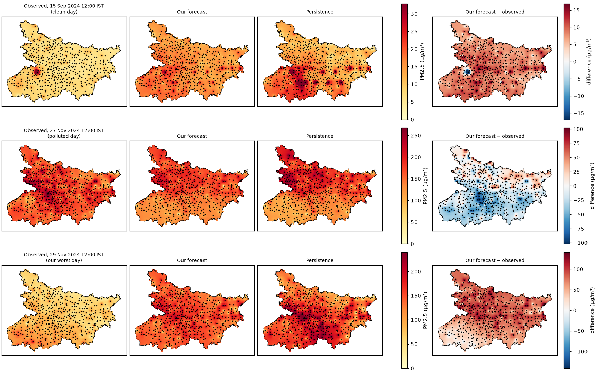

All numbers below come from `part0_kanpur_cleaning.ipynb` and `bihar_forecasting.ipynb`, which both
run from top to bottom with fixed seeds. Errors are in µg/m³. "Validation" always means every
station and every 12:00 target from 1 Sep to 30 Nov (91 days × 468 stations = 42,588 forecasts).

# Part 0: Cleaning the Kanpur data

**Format.** 76 sensors in three ID styles: 44 with 10-digit IDs, 31 with 8-character IDs and 1 with a
12-character ID. The 10-digit and 8-character sensors report at most once per hour, at minute :00
(about 16–19 readings a day). The 12-character sensor reports every 15 minutes. No sensor moves:
each has one fixed latitude and longitude. 10-digit sensors report whole numbers. 8-character
sensors report long decimals, which look like averages, at a slightly lower typical level (median
32 vs 37).

**Hourly table.** Readings are averaged within each hour, labelled by its start. Error codes are
excluded before averaging. Averaging only changes the 15-minute sensor: the mean differs from the
:00 reading by 2.6 on average and by up to 18.5 in single hours, and it uses four readings instead
of one, so it is less noisy.

**Flags.** Each sensor-hour gets the first rule that applies, in the order below, and then every hour of a
dropped sensor is relabelled `dropped_sensor`. Nothing is deleted or filled. "Caught" counts every hour
a rule matches; the final file has ok 79,512, dropped_sensor 1,734, stuck 559, spike 141,
error_code 136, zero 49.

| flag | rule and threshold | caught |
|---|---|---|
| error_code | hour contains only the code 999 (exact, repeated, far above the next-highest value of 968) | 136 h, 5 sensors (120 from `1204260025`) |
| zero | pm25 = 0 (outdoor PM2.5 is never exactly zero) | 813 h, 21 sensors, almost all from 2 sensors |
| stuck | same value for ≥ 24 consecutive reported hours (real PM2.5 follows a daily cycle) | 1,693 h, 7 sensors, e.g. 78 for 126 h, 14.2 for 74 h |
| spike | > 200 *and* > 5 × that hour's network median (city median ≈ 35 in the monsoon) | 141 h, half from 4 sensors |
| outage | fewer than 10% of sensors report that hour | 117 h (5–10 Aug) with **no** sensor reporting at all. Every other hour has ≥ 12%, so 10% cleanly separates the two. These hours have no readings, so no row carries the flag. |
| dropped_sensor | > 50% of a sensor's hours flagged | `1203260082` (73%), `1203260068` (58%) |

Correlation of each sensor's ok readings with the median of all other sensors (median r = 0.76)
shows two sensors that barely follow the network: `AC0BFBE34CC7` (r = 0.39) and `U8APQDBX`
(r = 0.47, also the most spikes). They are reported but not flagged, since a nearby local source
could also cause a low correlation.

**Calibration.** 21 ten-digit sensors have an eight-character sensor within 3 km. Fitted on July
and tested on August (ok hours only):

| correction (fit on July) | July MAE / RMSE | August MAE / RMSE |
|---|---|---|
| none | 10.79 / 16.98 | 11.73 / 18.07 |
| constant offset (−0.13) | 10.79 / 16.99 | 11.72 / 18.08 |
| linear, y = 19.9 + 0.48x | 10.46 / 15.45 | 13.11 / 18.81 |

No correction helps in August. Once bad readings are flagged, the families agree on average, so the
offset is about 0. The linear fit's slope below 1 is regression dilution from noise in x, and it
overfits July. The real cause shows up per pair: each pair has its own stable offset (between −10
and +10, correlation 0.92 between July and August), with different signs. So the disagreement is
location- and unit-specific, not a device-family effect, and one family-wide correction can't
remove it.

**Summary.** Before: 76 sensors, 82,131 sensor-hours, 27.4% missing. After (ok only): 74 sensors,
79,512 sensor-hours, 29.7% missing. The daily cycle (IST) is lowest in the afternoon and highest at
night, even in the monsoon.

# Part 1: Baselines

The baseline ridge uses 113,256 training rows (242 targets, 3 Jan – 31 Aug, × 468 stations: every
target with 24 h of history).

| | all | Sep | Oct | Nov |
|---|---|---|---|---|
| Persistence RMSE / MAE | 32.75 / 17.47 | 23.33 / 8.91 | 20.22 / 11.97 | 47.81 / 31.70 |
| Ridge (29 features) RMSE / MAE | 29.58 / 18.16 | 20.34 / 10.35 | 19.36 / 13.46 | 43.06 / 30.81 |

**Does one win on both metrics?** No. Ridge wins on RMSE and persistence wins on MAE. Ridge minimises
squared error, so the rare large misses on polluted days dominate its fit. It learns to shrink
forecasts towards the average, cutting extreme values and raising low ones (bias +3.5 to +6.9 per
month vs about 0 for persistence). That reduces big errors and so RMSE. But on the many ordinary
days, today's value is usually closer than a shrunk value, so ridge collects many small errors and a
higher MAE. A squared-error model targets the conditional *mean*. MAE is minimised by the *median*,
and for skewed data like PM2.5 the two differ.

# Part 2: Improved forecast

**Ideas.** (1) All features are `log(1 + PM2.5)`, because pollution changes multiplicatively.
(2) The target is the log change from today's reading, so the model predicts "today × a factor"
and regularisation shrinks towards persistence rather than a global mean. (3) A smearing
correction, `exp(σ²/2)`, removes the downward bias of exponentiating a mean log. (4) Ridge with
standardised features. The scaler is fitted on training rows only, inside a scikit-learn pipeline.

**Training rows.** 110,448: every noon target from 9 Jan to 31 Aug at every station. The first
week is skipped because the features need 7 days of history. Only noon issue times are used, so
training matches the task exactly.

**Feature groups and selection.** We started with 7 groups and removed groups by greedy backward
elimination on validation (alpha = 100). `past_days` (same hour on previous days, 7 daily means;
13 features) and `trends` (3, 6 and 24 h changes; 3 features) both made validation *worse*, so they
were dropped. Their information overlaps with the 24 hourly lags and the 30-day station level.
Alpha was then tuned on validation over {1, …, 10⁴}. Best: alpha = 300.

**Ablation of the final model** (remove one group, retrain with the same alpha; final RMSE 28.53):

| group removed | features | validation RMSE | change |
|---|---|---|---|
| recent_hours (last 24 hourly readings) | 24 | 35.66 | +7.13 |
| calendar (sin/cos day of year, weekend) | 3 | 29.96 | +1.43 |
| station_level (30-day mean, and vs state) | 2 | 29.15 | +0.62 |
| network (state mean now / 24 h / 7 days, 24 h change) | 4 | 28.85 | +0.32 |
| neighbourhood (10 nearest, ≤ 15 km, ≤ 40 km; now and 24 h) | 6 | 28.57 | +0.04 |

`recent_hours` carries most of the skill. `calendar` tells the model the season. Training has no
Sep–Dec dates, so this is partly extrapolation, but December resembles early January, which is in
training. `neighbourhood` adds little on top of `network` and the station's own lags, because
nearby stations move together with both.

**More flexible model.** A random forest on the same features and target fits the training months
far better (train RMSE 19.5 vs 26.6) but is much worse on validation (36.2 vs 28.5). It overfits
patterns specific to Jan–Aug (winter smog clearing, a calm monsoon) that don't transfer to the
Oct–Nov build-up, a season absent from training, and trees cannot extrapolate beyond the targets
they have seen. Ridge's single smooth rule transfers better, so ridge is the final model.

**Final results (validation)**

| | all | Sep | Oct | Nov |
|---|---|---|---|---|
| Persistence | 32.75 / 17.47 | 23.33 / 8.91 | 20.22 / 11.97 | 47.81 / 31.70 |
| Ridge (29 features) | 29.58 / 18.16 | 20.34 / 10.35 | 19.36 / 13.46 | 43.06 / 30.81 |
| **Our model** | **28.53 / 15.96** | 20.70 / **8.09** | **17.39 / 10.97** | **41.56 / 28.98** |

(RMSE / MAE.) Our model beats both baselines overall on both metrics, and in October and November.
In September its RMSE is 0.4 worse than ridge's. The gain is real but modest.

**What would help most:** weather forecasts (wind, rain, boundary-layer height, inversions), which
drive most day-to-day changes in PM2.5, and satellite fire counts for the Oct–Nov crop-burning
season.

# Part 3: Lead time

{width=100%}

| lead | Persistence | Ridge (29) | Our model |
|---|---|---|---|
| **1 h (nowcast)** | 23.95 / 10.36 | **18.95** / 8.67 | 19.13 / **8.41** |
| 3 h | 51.43 | 28.37 | 31.83 |
| 6 h | 66.82 | 33.72 | 39.41 |
| 12 h | 72.74 | 31.70 | 34.19 |
| **24 h (day-ahead)** | 32.75 / 17.47 | 29.58 / 18.16 | **28.53 / 15.96** |

(Validation RMSE, and MAE for 1 h and 24 h.)

**Persistence** is far from monotonic. Its error is lowest at 1 h, peaks at 12 h (issued at
midnight), and drops back at 24 h. Persistence copies the value at the issue hour, and night hours
sit near the daily peak, about 1.5–2 times the noon level in Sep–Nov, while 24 h earlier is noon again, the
same phase of the daily cycle.

**The learned models** show a weaker version of the same hump: 6 h is worse than 24 h on
validation. On *training* data the order is as expected (our model: 23.6 at 6 h vs 26.6 at 24 h). A
night issue time requires converting a night value to a noon value, and the night/noon ratio is
unstable. It ranges from 1.1 (Jul–Aug) to 2.5 (Mar–Apr) by month and also varies with daily
weather. One pooled conversion is wrong on many validation days. Noon-to-noon needs no conversion.

**For a public warning service** we'd use the 24 h lead. The 1-hour nowcast is more accurate (RMSE
about 19 vs 29), but it leaves no time to act, while a day-ahead warning lets people and schools
plan. That costs about 10 µg/m³ of RMSE. Intermediate leads (3–12 h) are, here, both less useful and
less accurate.

# Part 4: Maps

Stations are interpolated to the 3,396-point grid with IDW (p = 2, all stations), using one fixed
weight matrix for observed and forecast values.

{width=100%}

| mean over 91 validation days | station RMSE | map RMSE | pattern correlation |
|---|---|---|---|
| Persistence | 28.57 | 15.37 | 0.580 |
| Our model | 24.96 | 13.96 | 0.602 |

On the worst day (29 Nov) the air cleaned up sharply overnight, and both forecasts stayed at the
previous day's smog level. The error map is positive almost everywhere.

**Which RMSE is better, and which to quote?** Map RMSE is lower, because IDW averages neighbours
and smooths out station-level errors in both maps. We should quote **station RMSE**, since it
compares forecasts with actual measurements. Map RMSE compares two interpolations.

**Why the observed map isn't ground truth.** Between stations it is a weighted average, not a
measurement. It can't show hotspots between sensors, it is least reliable where stations are sparse
(edges of the state), and it inherits sensor errors and the unmarked upstream gap-filling.

**Good pattern correlation, poor RMSE.** A forecast that ranks the districts correctly but is 40%
too low everywhere on a smog day has a correlation near 1 and a large RMSE. For a public warning,
the level matters more, because warnings are triggered by fixed thresholds.

# Part 5: Hidden December test

`submission/forecast.py` loads `model.pkl`, which holds the Part 2 ridge refitted on all 153,036
noon targets up to 30 Nov with alpha = 300, saved as plain numpy arrays (scaler mean and scale,
coefficients, intercept, smearing term) so it does not depend on the grader's scikit-learn version.
It also uses the same `features.py` as the notebook and `bihar_stations.csv`. Nothing is refitted
inside `forecast()`. If a reading were ever missing, it is carried forward from the same station's
last value, so a gap can't crash a call. `check_submission.py` passes: median call 0.16 s,
maximum 0.21 s (limit 10 s). The November sanity RMSE (41.3, vs 47.8 for
persistence) is in-sample after the refit, so it is not a test score.

# Limitations

Validation is a single autumn and contains a season (the Oct–Nov smog build-up) that training
never sees, so model choices are tuned to that one shift. Gap-filled values in the Bihar data are
not marked, so part of the error is in the "truth" itself. Without weather data, sudden clean-ups
like 29 Nov can't be anticipated.

# Use of AI tools

_[Edit this to match exactly what your group did.]_ We used Claude (Anthropic) as a coding
assistant to draft and debug the analysis code, run the experiments, make the plots and draft parts
of this report text. All modelling choices were checked against validation results, and we
verified the leakage rules (features at or before the issue time, scaler fitted on training rows,
time-based split). Every group member has gone through the code and can explain it.
