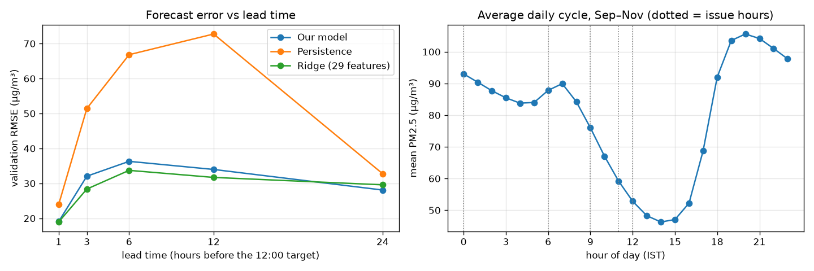

All numbers in this report come from our two notebooks, `part0_kanpur_cleaning.ipynb` and
`bihar_forecasting.ipynb`. Both run from top to bottom with fixed random seeds. All errors are in
µg/m³. When we say "validation", we always mean every station and every 12:00 target from 1 Sep to
30 Nov, which is 91 days × 468 stations = 42,588 forecasts.

# Part 0: Cleaning the Kanpur data

**What the data looks like.** There are 76 sensors with three kinds of IDs: 44 have 10-digit IDs, 31
have 8-character IDs and 1 has a 12-character ID. The 10-digit and 8-character sensors send at most
one reading per hour, always at minute :00, which comes to about 16–19 readings a day. The
12-character sensor sends a reading every 15 minutes. No sensor moves: each one always has the same
latitude and longitude. The 10-digit sensors give whole numbers. The 8-character sensors give long
decimals, which look like averages, and their readings are a little lower (median 32 vs 37).

**Making an hourly table.** We take the average of all readings inside each hour and label the hour by
its start time. Error codes are removed before averaging. This only matters for the 15-minute
sensor. Its hourly average differs from its :00 reading by 2.6 on average and by up to 18.5 in some
hours. The average uses four readings instead of one, so it is less noisy.

**Flags.** We do not delete anything and we do not fill gaps. Instead, each sensor-hour gets a flag:
the first rule in the table below that matches it. After that, every hour of a "dropped" sensor is
re-labelled `dropped_sensor`. The "caught" column counts every hour a rule matches. The final file
has ok 79,512, dropped_sensor 1,734, stuck 559, spike 141, error_code 136 and zero 49.

| flag | rule and why we chose it | caught |
|---|---|---|
| error_code | the hour has only the value 999 (it repeats exactly, and is far above the next-highest value, 968) | 136 h, 5 sensors (120 from `1204260025`) |
| zero | pm25 = 0 (outdoor PM2.5 is never exactly zero) | 813 h, 21 sensors, almost all from 2 sensors |
| stuck | same value for 24 or more reported hours in a row (real PM2.5 goes up and down every day) | 1,693 h, 7 sensors, e.g. 78 for 126 h, 14.2 for 74 h |
| spike | above 200 *and* above 5 × that hour's median over all sensors (the city median is about 35 in the monsoon) | 141 h, half of them from 4 sensors |
| outage | fewer than 10% of sensors report in that hour | 117 h (5–10 Aug) where **no** sensor reports at all. Every other hour has at least 12%, so 10% separates the two cleanly. These hours have no readings, so no row has this flag. |
| dropped_sensor | more than 50% of the sensor's hours are flagged | `1203260082` (73%), `1203260068` (58%) |

We also checked how well each sensor follows the rest of the city. For each sensor we took the
correlation of its ok readings with the median of all other sensors. The typical value is 0.76.
Two sensors barely follow the city: `AC0BFBE34CC7` (0.39) and `U8APQDBX` (0.47, which also has the
most spikes). We report them but do not flag them, because a nearby local source of pollution could
also give a low correlation.

**Calibration check.** 21 of the 10-digit sensors have an 8-character sensor within 3 km. We fitted
a correction on July and tested it on August (ok hours only):

| correction (fitted on July) | July MAE / RMSE | August MAE / RMSE |
|---|---|---|
| none | 10.79 / 16.98 | 11.73 / 18.07 |
| constant offset (−0.13) | 10.79 / 16.99 | 11.72 / 18.08 |
| straight line, y = 19.9 + 0.48x | 10.46 / 15.45 | 13.11 / 18.81 |

No correction helps in August. Once the bad readings are flagged, the two kinds of sensor agree on
average, so the best constant offset is almost 0. The straight line has a slope below 1 only because
x is noisy (regression dilution). It fits July better but does worse in August, so it overfits.
The real reason the pairs disagree shows up when we look at each pair separately. Each pair has its
own offset, between −10 and +10, and the offset stays the same from July to August (correlation
0.92). The offsets have different signs. So the difference comes from each location and each
device, not from the type of device, and one correction for the whole family cannot remove it.

**Before and after.** Before: 76 sensors, 82,131 sensor-hours, 27.4% missing. After (ok only):
74 sensors, 79,512 sensor-hours, 29.7% missing. Over the day (in IST), PM2.5 is lowest in the
afternoon and highest at night, even in the monsoon.

# Part 1: Baselines

The baseline ridge uses 113,256 training rows: 242 target days (3 Jan – 31 Aug) × 468 stations. These
are all the targets that have 24 hours of history before them.

| | all | Sep | Oct | Nov |
|---|---|---|---|---|
| Persistence RMSE / MAE | 32.75 / 17.47 | 23.33 / 8.91 | 20.22 / 11.97 | 47.81 / 31.70 |
| Ridge (29 features) RMSE / MAE | 29.58 / 18.16 | 20.34 / 10.35 | 19.36 / 13.46 | 43.06 / 30.81 |

**Does one baseline win on both metrics?** No. Ridge has the lower RMSE, and persistence has the
lower MAE. Ridge is trained to make the *squared* error small, so a few very large misses on
polluted days matter most to it. To avoid them, it pulls its forecasts towards the average: high
values come down and low values go up. Its forecasts are too high by 3.5 to 6.9 on average in each
month, while persistence is off by about 0. This avoids the biggest misses, so RMSE goes down. But on
most ordinary days, today's value is closer to tomorrow's than the pulled-in value is. So ridge makes
many small errors and its MAE goes up. In short, squared error is smallest at the *mean*, absolute
error is smallest at the *median*, and for skewed data like PM2.5 these two are different.

# Part 2: Improved forecast

**Main ideas.**

1. We use `log(1 + PM2.5)` for every feature, because pollution changes by percentages, not by
   fixed amounts.
2. The model predicts the change in log PM2.5 from today's reading. This means the forecast is
   "today's value × a factor". When ridge shrinks this factor, it moves the forecast towards today's
   value (persistence) instead of towards one overall average.
3. Turning a predicted log value back with `exp` gives forecasts that are a bit too low on average.
   We fix this by multiplying by `exp(σ²/2)` (a "smearing" correction), where σ² is the variance of
   the training errors.
4. We use ridge with standardised features. The scaler is fitted on training rows only, inside a
   scikit-learn pipeline.
5. We mix the forecast with persistence: 0.9 × our forecast + 0.1 × today's reading. The weight
   was chosen on validation (we tried 0.5 to 1.0).
6. **State-wide bias correction**, as used in operational PM2.5 forecasts (e.g. NOAA's Kalman-filter
   correction). At the issue time we already know how wrong yesterday's forecast was, because its
   target is the reading at the issue time. We add 0.3 × the state-wide mean of that error (in log
   space) to today's forecast. The 0.3 is fixed and nothing is refitted.

**Training rows.** 110,448: every 12:00 target from 9 Jan to 31 Aug at every station. We skip the
first week because some features need 7 days of history. We only use 12:00 issue times, so training
looks exactly like the real task.

**Where the error comes from.** Before choosing features we looked at our errors. November causes
70% of the squared error, and the worst 10 days (all in late November) cause 43%. Targets above 200
are only 2.7% of rows but cause 38% of the squared error, and on them we forecast too low by 79 on
average. Only 18% of the error is the whole state being off together; the rest is single stations
jumping. So we added a `variability` group that describes how unsettled the air is: how much the
station went up and down in the last 24 h (std), and how much its 10 nearest neighbours changed in
the last 24 h (2 features).

**Choosing feature groups.** We had 8 groups. We removed one group at a time, kept the removal if
validation got better, and repeated. Then we tuned alpha over {1, …, 10⁴}, ran the group removal
again with that alpha, and stopped when neither the groups nor alpha changed. This dropped
`past_days` (the same hour on the previous 6 days and the last 7 daily means, 13 features) and
`trends` (changes over 3, 6 and 24 h, 3 features). The 24 hourly readings and the 30-day station
level already carry the same information. On validation alpha = 300 and 1000 were within 0.01
(28.49 vs 28.50), so we took 1000: stronger regularisation is safer for a new month. Final:
6 groups, 41 features, alpha = 1000.

**Ablation of the final model.** We remove one group, retrain with the same alpha and compare with
the final validation RMSE of 28.50 (before mixing with persistence):

| group removed | features | validation RMSE | change |
|---|---|---|---|
| recent_hours (last 24 hourly readings) | 24 | 36.35 | +7.85 |
| calendar (sin/cos of day of year, weekend) | 3 | 29.59 | +1.09 |
| station_level (30-day mean, and how it compares with the state) | 2 | 29.39 | +0.89 |
| network (state mean now, over 24 h and over 7 days, and its 24 h change) | 4 | 28.75 | +0.25 |
| neighbourhood (10 nearest stations, within 15 km and within 40 km; now and over 24 h) | 6 | 28.58 | +0.08 |
| variability (station std over 24 h, neighbours' 24 h change) | 2 | 28.53 | +0.03 |

Most of the skill comes from `recent_hours`. `calendar` tells the model the season. Training has no
dates from Sep–Dec, so here the model has to go beyond what it has seen, but December is similar to
early January, which is in training. `neighbourhood` and `variability` add very little, because
nearby stations move together with the station itself and with the whole state, which other groups
already cover.

**A more flexible model.** We tried a random forest with the same features and target. It fits the
training months much better (train RMSE 19.4 vs 26.6) but is much worse on validation (36.4 vs 28.5).
It overfits. It learns patterns that only hold in Jan–Aug, like how the winter smog cleared and how
calm the monsoon was. These do not carry over to the smog build-up in Oct–Nov, a season that is not
in training at all. Trees also cannot predict values outside the range they saw in training.
Ridge learns one simple, smooth rule, and that works better on new months. So ridge is our final model.

**Final results on validation (RMSE / MAE)**

| | all | Sep | Oct | Nov |
|---|---|---|---|---|
| Persistence | 32.75 / 17.47 | 23.33 / 8.91 | 20.22 / 11.97 | 47.81 / 31.70 |
| Ridge (29 features) | 29.58 / 18.16 | 20.34 / 10.35 | 19.36 / 13.46 | 43.06 / 30.81 |
| Our model, before mixing | 28.50 / 16.10 | 20.54 / 8.23 | 17.53 / 11.21 | 41.52 / 29.02 |
| Our model, mixed, no bias correction | 28.39 / 15.98 | 20.23 / 8.15 | 17.42 / 11.10 | 41.51 / 28.86 |
| **Our model (final)** | **28.04 / 15.56** | **20.25 / 7.91** | **17.08 / 10.65** | **40.91 / 28.29** |

Our final model beats both baselines on both metrics, overall and in every month. Mixing adds a
little (28.50 → 28.39) and the bias correction more (→ 28.04). We chose its weight (0.3) on Sep–Oct
only and then checked it on November, which it had not seen: November RMSE went from 41.51 to 40.91.
It helps most in the Oct–Nov build-up, when a model trained on Jan–Aug is wrong in the same
direction several days in a row; it cannot foresee sudden clean-ups like 29 Nov. The improvement is
real, but small.

**Other things we tried that did not help** (validation RMSE, before bias correction): giving
recent months more weight (28.7 to 36.7), Huber loss (28.5), gradient boosting (34.7 to 41.1),
squared and interaction terms (29.3 to 31.0), fewer lags or PCA of the lags (28.5 to 31.5), a
feature-dependent smearing correction (28.6), latitude/longitude or K-means station clusters
(28.4), separate models for the dirtiest 2–50% of stations (28.4 to 28.9, and worse on those
stations themselves), training on the polluted months only (28.7 to 56), an analog ensemble (28.6
mixed in, 35 alone) and a per-station bias correction (28.3).

**What would help most:** weather forecasts (wind, rain, mixing height, temperature inversions),
because weather causes most of the day-to-day change in PM2.5. Satellite counts of crop fires
would also help in the Oct–Nov burning season.

# Part 3: Lead time

{width=100%}

| lead | Persistence | Ridge (29) | Our model* |
|---|---|---|---|
| **1 h (nowcast)** | 23.95 / 10.36 | **18.95** / 8.67 | 19.23 / **8.40** |
| 3 h | 51.43 | 28.37 | 32.44 |
| 6 h | 66.82 | 33.72 | 41.17 |
| 12 h | 72.74 | 31.70 | 37.18 |
| **24 h (day-ahead)** | 32.75 / 17.47 | 29.58 / 18.16 | **28.39 / 15.98** |

(Validation RMSE, plus MAE for 1 h and 24 h. *Without the bias correction, so every lead uses the same rule.)

**Persistence does not get steadily worse with lead time.** Its error is lowest at 1 h, highest at
12 h (issued at midnight), and low again at 24 h. Persistence just copies the reading at the issue
hour. Night hours are near the daily peak, about 1.5–2 times the noon level in Sep–Nov, so copying
them gives forecasts that are far too high. 24 hours earlier is noon again, the same point in the
daily cycle, so persistence does well again.

**The learned models show a smaller version of the same bump.** On validation, 6 h is worse than
24 h. On the *training* data the order is as you would expect (our model: 24.2 at 6 h vs 26.6 at
24 h). A forecast made at night has to turn a night value into a noon value, and the night/noon ratio
is not stable. It goes from 1.1 (Jul–Aug) to 2.5 (Mar–Apr) by month, and it also changes with the
weather each day. One average conversion is wrong on many validation days. A noon-to-noon forecast
does not need any conversion.

**For a public warning service** we would use the 24 h lead. The 1-hour nowcast is more accurate
(RMSE about 19 vs 28), but it leaves no time to act. A day-ahead warning lets people and schools plan.
That costs about 10 µg/m³ of RMSE. The leads in between (3–12 h) are both less useful and, in our
data, less accurate.

# Part 4: Maps

We spread the station values onto the 3,396-point grid using inverse distance weighting (power 2,
all stations). We use the same weights for the observed and the forecast maps.

{width=100%}

| mean over the 91 validation days | station RMSE | map RMSE | pattern correlation |
|---|---|---|---|
| Persistence | 28.57 | 15.37 | 0.580 |
| Our model | 24.51 | 13.54 | 0.616 |

On our worst day (29 Nov), the air suddenly got much cleaner overnight, but both forecasts stayed at
the smog level of the day before. That is why the error map is positive almost everywhere.

**Which RMSE is better, and which should we quote?** The map RMSE is lower, because the interpolation
averages nearby stations and smooths out station-level errors in both maps. We should quote the
**station RMSE**, because it compares forecasts with real measurements. The map RMSE only compares
two interpolated maps.

**Why the observed map is not the real truth.** Between stations it is a weighted average, not a
measurement. It cannot show a hotspot that falls between sensors. It is least reliable where there
are few stations (near the edges of the state). It also carries any sensor errors and the gap-filling
that was done before we got the data.

**Good pattern correlation but poor RMSE.** Imagine a forecast that gets the order of the districts
right (which are worst and which are best) but is 40% too low everywhere on a smog day. Its
correlation is close to 1, but its RMSE is large. For a public warning, getting the level right
matters more, because warnings are given when PM2.5 crosses fixed limits.

# Part 5: Hidden December test

`submission/forecast.py` loads `model.pkl`. This is our Part 2 ridge, refitted on all 153,036 noon
targets up to 30 Nov with alpha = 1000, the same 0.9 / 0.1 mix and the 0.3 bias correction. We save it as
plain numpy arrays (scaler mean and scale, coefficients, intercept, smearing term and the two weights), so it does not depend on the grader's scikit-learn
version. It uses the same `features.py` as the notebook, and `bihar_stations.csv`. Nothing is
refitted inside `forecast()`; for the bias correction it recomputes yesterday's forecast from the history it is given. If a reading is ever missing, we fill it with the same station's last
value, so a gap cannot crash a call. `check_submission.py` passes: each call takes about 0.2 s (the limit is
10 s). The November check gives RMSE 40.8 (persistence: 47.8), but this
is not a test score, because November is now part of the training data.

# Limitations

Validation is only one autumn, and it includes a season (the Oct–Nov smog build-up) that training
never sees. So our choices are tuned to that one change of season. The gap-filled values in the
Bihar data are not marked, so some of the "true" values are themselves estimates. Without weather
data, we cannot predict sudden clean-ups like the one on 29 Nov.

# Use of AI tools

We used Claude (Anthropic) as a coding assistant to draft and debug the analysis code, run the
experiments, make the plots and draft parts of this report. We checked all modelling choices
against the validation results, and we checked the leakage rules ourselves (features only from
data at or before the issue time, scaler fitted on training rows only, split by time). Every group
member has gone through the code and can explain it.
